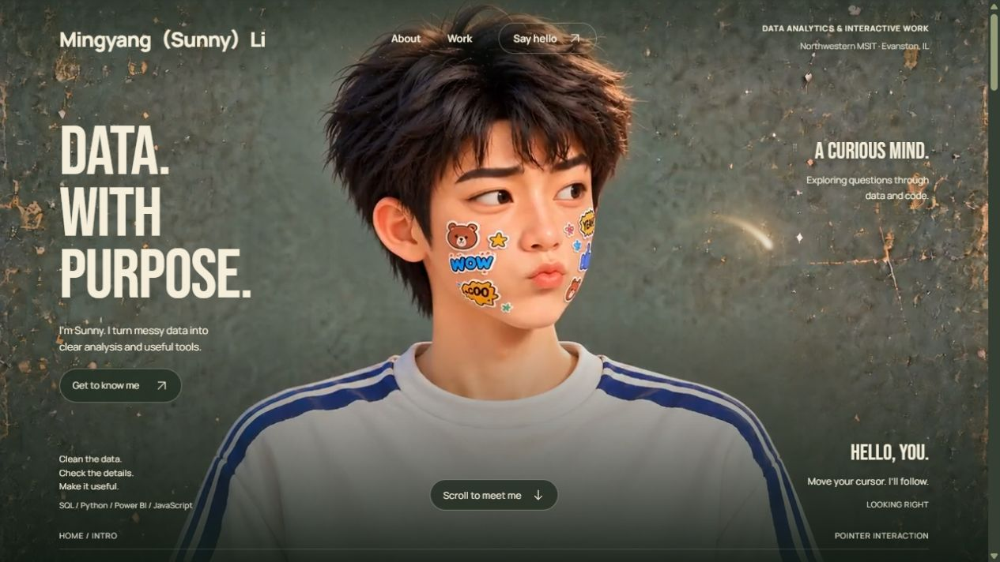

# Sunny Li — Interactive Portfolio

A personal portfolio combining data analytics projects, a scroll-driven career story, and a playful 3D clay character.

**[Visit the live website](https://mingyang-sunny-li.netlify.app/)**



## What it does

- Desktop pointer tracking samples an approved eight-direction character video.
- On touchscreens, a short tap in the portrait looks toward the tap, then returns to front. Swipes and multi-touch cancel the gesture.
- A continuous main film follows page scroll in both directions. Biography text has its own smooth reading rail within measured video pose windows.
- A chroma-keyed folder opens three project collections; project detail views support Back and a two-level Escape flow.
- A warm WebGL glow follows a fine pointer across the page and native project dialog.
- Sanity manages project content, experience, contact information and selected copy. Netlify Functions provide published content and signed draft-preview sessions.
- Responsive layouts and a reduced-motion / media-error reading mode preserve access to the content.

## Stack

Vanilla JavaScript, HTML and CSS for the interactive frontend; WebGL2 for the cursor effect; TypeScript, React and Sanity for the editing studio; Netlify Functions for server-side content and previews.

## Run locally

Use **Node.js 22.18 or newer** and npm. No account or token is needed for the bundled fallback version.

```sh
npm --prefix cms ci
npm run check
npm run dev
```

Open **http://127.0.0.1:5190/**. `check` builds the frontend and four functions, checks TypeScript, and runs the content/preview/media tests plus touch-gesture tests. The preview server is bound to loopback.

For optional Sanity access, copy `cms/.env.example` to `cms/.env` and configure your own project. With `SANITY_PROJECT_ID` blank, the server serves the local fallback. No production credentials or Studio deployment identity are included.

## Repository map

| Path | Purpose |
| --- | --- |
| `website/` | Character interaction, biography, project folder, styles, fonts and web media |
| `cms/browser/` | Browser-side content updates |
| `cms/schema/` | Sanity document schemas and preview actions |
| `cms/content/` | Content types, normalization, queries and a bundled fallback |
| `cms/netlify/` | Content, page and signed-preview server functions |
| `cms/tools/` | Self-contained build, local preview and explicit migration tools |
| `tests/` | Tap-versus-scroll and gesture cancellation checks |
| `release/frontend-files.json` | Explicit frontend asset list used by the build |

## Architecture and timing

The character is pre-rendered footage, not a live 3D model or camera-based eye tracking. `gazeKnots` in `website/app.js` maps pointer angle to measured frames of the gaze film. `SeekQueue` coalesces seeks; main-film requests are quantized to the original 24 fps frames.

The biography is gated by real decoded video positions at scene boundaries. Within the stable presenting pose, text follows its own display-rate clock. Leaving the hero returns the character to neutral before the main film is shown. The folder reuses a keyed video and opens a native dialog; the glow canvas moves into the dialog's top layer when needed.

Changing the source films requires measuring their poses and updating the mappings. Raising the animation loop's rate alone does not add new frames to the films.

## Content editing and deployment

The live site uses Sanity and Netlify. Publishing content in the owner's Studio updates the existing site independently of this repository. The bundled fallback is an earlier five-project snapshot; the live catalog can contain newer projects and screenshots.

For a separate Studio, configure your own environment, create the required `production` and `staging` datasets, and run `npm --prefix cms run studio:dev`. The optional `npm --prefix cms run import` writes the bundled seed into the configured dataset using a temporary import credential; it is never run by the build or CI.

For your own Netlify deployment, use `cms` as the base directory, `npm run build` as the build command, `dist` as the publish directory and `netlify/functions` as the functions directory. Configure server-only credentials in the hosting platform; public Studio variables must never contain read/write tokens or the preview-session secret. Set your own site origin and Sanity CORS/preview origins before enabling previews.

This repository is a curated, self-contained source release of the working project. It is **not connected to automatic production deployment**. Pushing here does not redeploy the owner's live site or Studio. Local project archives, credentials, resumes, execution logs and test captures are deliberately excluded.

## Validation and limits

The source release is checked with a fresh dependency install, build, TypeScript, and automated tests. Existing site checks covered desktop interaction and mobile-size browser layouts. Mobile gaze was checked using dispatched touch pointer events; this is not physical iPhone/Android or Safari certification. Weak-network loading and device GPU performance can vary. The films remain 24 fps.

## Credits and reuse

See [ASSET_NOTICES.md](ASSET_NOTICES.md). The Glow Cursor adaptation includes the original React Bits MIT + Commons Clause notice, and the bundled fonts include their SIL Open Font License files. Public source availability does not grant a blanket license to the portrait, generated films, project screenshots, third-party assets or other application code. No general open-source license is asserted for this repository.
